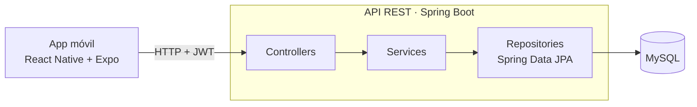
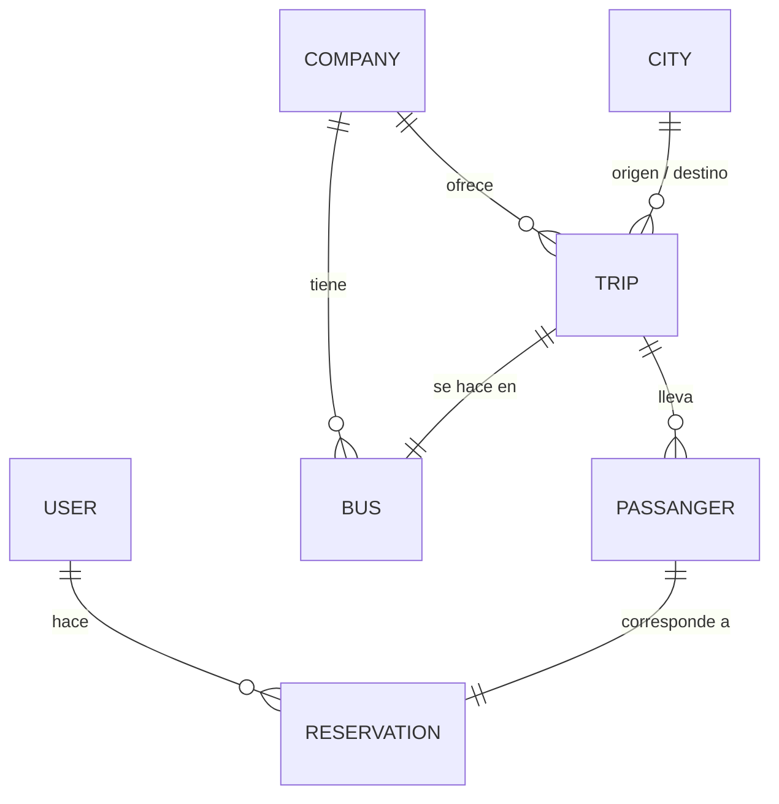

<div align="center">
  
  <p><b>App móvil para buscar y reservar pasajes de colectivos de larga distancia, con su API REST.</b></p>
  <p>
    
    
    
    
    
  </p>
</div>

---

## Sobre el proyecto

GoTicket simula una app de venta de pasajes de colectivos de larga distancia. Es el proyecto final de **Programación 2** en la Universidad de Mendoza (2023), desarrollado en equipo.

El repositorio reúne las dos partes:

| Carpeta | Qué contiene |
| --- | --- |
| [`backend/`](backend) | API REST en Spring Boot con persistencia en MySQL |
| [`frontend/`](frontend) | App móvil en React Native con Expo |

## Funcionalidades

- **Registro e inicio de sesión.** Las contraseñas se guardan con hash Argon2id y la sesión se maneja con un JWT firmado con HS256 que dura una semana. La app guarda el token en el dispositivo y lo envía en cada pedido.
- **Búsqueda de viajes** por ciudad de origen y destino. El listado viene paginado, se puede ordenar y también filtrar por empresa.
- **Reservas.** Cada reserva descuenta un asiento disponible del colectivo y se rechaza si ya no quedan lugares.
- **Administración** de empresas, colectivos, ciudades, viajes, pasajeros y usuarios.

> **Estado actual:** el login, el registro y la búsqueda de viajes están conectados a la API. Las pantallas de detalle del colectivo y de perfil todavía muestran datos de ejemplo.

## Arquitectura



### Modelo de datos



## Tecnologías

| Parte | Tecnologías |
| --- | --- |
| Backend | Java 17, Spring Boot 3.1 (Web, Data JPA, AOP), Hibernate, MySQL, JJWT, Argon2 |
| Frontend | React Native 0.72, Expo 49, React Navigation, Axios, AsyncStorage, React Native Paper |

## Cómo correrlo

### Backend

Requisitos: Java 17 y MySQL.

1. Crear la base de datos `db_GoTicketUM` en MySQL.
2. Completar `backend/src/main/resources/application.properties` con los datos propios:

   ```properties
   server.port=4000
   spring.datasource.url=jdbc:mysql://localhost:3306/db_GoTicketUM
   spring.datasource.username=tu_usuario
   spring.datasource.password=tu_password
   spring.jpa.hibernate.ddl-auto=update

   security.jwt.secret=tu_clave_secreta
   security.jwt.issuer=Main
   security.jwt.ttlMillis=604800000
   ```

3. Levantar la API:

   ```bash
   cd backend
   ./mvnw spring-boot:run
   ```

La API queda en `http://localhost:4000`. En `backend/` hay una colección de Insomnia (`InsomniaGoTicket.json`) para probar los endpoints.

### Frontend

Requisitos: Node.js 18 y la app Expo Go en el celular, o un emulador.

```bash
cd frontend
npm install
npx expo start
```

La URL de la API se configura en [`frontend/src/api/ticketApi.js`](frontend/src/api/ticketApi.js). Por defecto apunta a `http://localhost:4000`; para probar en un celular hay que poner la IP de la computadora donde corre el backend.

## Endpoints

| Recurso | Endpoints |
| --- | --- |
| Autenticación | `POST /login` · `POST /register` |
| Usuarios | `GET /user` · `POST /user` · `GET /user/{id}` · `PUT /user/{id}` · `DELETE /user/{id}` |
| Empresas | `GET /company` · `GET /company/filtered` · `POST /company` · `GET /company/{id}` · `PUT /company/{id}` · `DELETE /company/{id}` |
| Colectivos | `GET /bus` · `GET /bus/filtered` · `POST /bus` · `GET /bus/{id}` · `PUT /bus/{id}` |
| Ciudades | `GET /city` · `GET /city/filtered` · `POST /city` · `GET /city/{id}` · `PUT /city/{id}` |
| Viajes | `GET /trip` · `POST /trip` · `GET /trip/{id}` · `DELETE /trip/{id}` |
| Reservas | `GET /reservation` · `GET /reservation/filtered` · `POST /reservation` · `GET /reservation/{id}` · `DELETE /reservation/{id}` |
| Pasajeros | `GET /passanger` · `POST /passanger` · `GET /passanger/{id}` · `DELETE /passanger/{id}` |

`GET /trip` acepta los parámetros `page`, `size`, `sortBy`, `company`, `cityFrom` y `cityTo`.

## Equipo

- [Ezequiel Garcia](https://github.com/Ezeg914)
- [Bruno Rosales](https://github.com/bruno212121)
- [Enzo Fernandez](https://github.com/EnzoFer)
